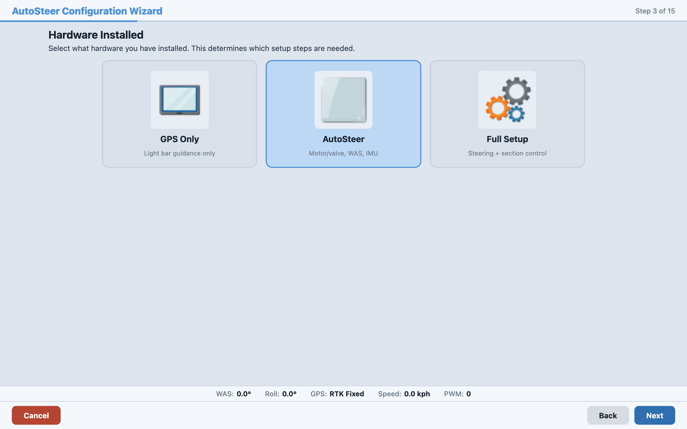

The **Steer Wizard** takes you through the whole AutoSteer setup in order. It
asks for the tractor's measurements, then runs the calibration tests one at a
time and fills in the results for you.

Start it from **Tools** on the left bar, then **Steer Wizard**. It is also at
the bottom of the full [AutoSteer panel](/software/setup/autosteer/).

## Before you start

- Make a [vehicle profile](/software/setup/profiles/) for this tractor and
  load it. The wizard saves into the profile in use.
- Park on **level ground** with room to drive in circles: an empty yard or a
  stubble field.
- The GPS should have a position, with **RTK Fixed** if you can. The circle
  tests measure with it.
- The steer module must be answering: check
  [Network IO](/software/connect/network-io/).
- Turn the [simulator](/software/simulator/) off. The tests need the real GPS
  and the real steering.

:::danger[The steering moves by itself]
Two of the tests turn the steering wheel by themselves, one of them to full
lock on both sides. Keep hands, arms and loose clothing away from the
wheel, and keep people away from the front wheels.
:::

## How it works

The line at the bottom shows live readings all the way through: the wheel
angle (**WAS**), **Roll**, the **GPS** quality, **Speed**, and the power going
to the motor (**PWM**).

**Next** and **Back** move between steps. A test step can be skipped, and the
last page lists the tests you did not run. **Cancel** closes the wizard.

If your steer module has a steer switch, it must be on for the tests that move
the wheels. The wizard tells you when it is not.

The wizard closes by itself if the screen in control stops answering, for
example when the tablet goes to sleep. Open it again to go on.

## The steps

There are 15. With **GPS Only** chosen in step 3, the steering steps are left
out.

### 1 to 5: the tractor

1. **Welcome.**
2. **Vehicle Type**: tractor, harvester, or 4WD / articulated.
3. **Hardware Installed**:
   - **GPS Only**: you steer yourself by the light bar.
   - **AutoSteer**: a steering motor or valve, a wheel angle sensor and an IMU.
   - **Full Setup**: AutoSteer and section control.
4. **Vehicle Dimensions**: wheelbase and track width.
5. **Antenna Position**: pivot distance, height and offset.

How to measure these is on the [Vehicle](/software/setup/vehicle/) page.

### 6: Hardware Configuration

| Setting                   | Choose                                                                       |
| ------------------------- | ---------------------------------------------------------------------------- |
| Steer enable method       | **None**, a **Switch** or a **Button** wired to the steer module             |
| Motor driver              | **IBT2** or **Cytron**, whichever your board has                             |
| A/D converter             | **Differential** or **Single**, to match how the wheel angle sensor is wired |
| Invert steer enable relay | For a relay that works the other way round                                   |
| Danfoss valve             | On for a Danfoss proportional steering valve                                 |

If you do not know, see the page for your board in the
[Hardware](/hardware/) section.

### 7: Roll Calibration

1. Tilt the tractor a little to the right. The gauge should move to the right.
   If it moves left, switch **Invert roll** on.
2. Park on level ground and tap **Zero Roll**.

If the roll does not read close to level, the wizard asks whether the ground
really is level. Tap **Zero Roll** again to confirm.

### 8: Wheel Angle Sensor

1. Point the wheels straight ahead. Driving forward a few metres with the
   wheel held straight is the surest way.
2. Tap **Zero WAS**.
3. Turn the wheels to the **right**. The angle should be positive. If it is
   negative, switch **Invert WAS** on.

As with the roll, a reading far from zero must be confirmed with a second tap.

### 9: Auto Motor Calibration

**The steering moves.** Tap **Start Motor Test** and keep clear. The wizard
asks for a small turn and raises the power until the wheels respond. From that
it finds:

- which way the motor turns, and sets **Invert motor** if needed,
- the least power that moves the wheels (**Minimum PWM**).

If the wheels do not move at all, check that nothing is holding them, that the
motor is engaged, and its power supply. If the wheel runs away, the test stops
by itself: check the wheel angle sensor first.

### 10: Maximum Steering Angle

**The steering moves to full lock**, right then left. Tap **Start Max Angle
Test** and keep clear. On a tractor whose steering is heavy when standing
still, do it with the engine at idle on level ground.

The result is the largest angle AutoSteer will ask for. If the wheels do not
reach the lock in the time the test allows, you can type the angle later in
the AutoSteer panel.

If the wheels turn the wrong way, go **Back** and run the motor test first.

### 11: CPD Circle Test

This finds **counts per degree**: how much the sensor's reading changes for
one degree of wheel angle.

1. Turn the steering wheel about 20° to the **right** and hold it still.
2. Drive in a steady circle at about 5 km/h.
3. Tap **Record** and keep the circle going.

AgOpenWeb measures the circle from the GPS and works out the value. It needs
at least half a circle, driven without stopping and without moving the wheel.

### 12: Ackermann Calibration

The same again to the **left**: about 20°, a steady circle, **Record**. This
corrects for the inner and outer wheels turning by different amounts.

### 13: Steering Gains

Starting values for how the tractor follows the line. Leave them as they are
the first time, and tune them afterwards while driving: see
[AutoSteer settings](/software/setup/autosteer/).

### 14: Speed and Sensors

- **Min steer speed** and **Max steer speed**: AutoSteer works only between
  these.
- **Turn Sensor**, **Pressure sensor**, **Current sensor**: switch on the one
  your tractor has. It lets you take over by turning the wheel.
- **Steer in reverse**: allow AutoSteer while backing up.

### 15: Setup Complete

The page lists any tests you skipped. Tap **Finish** to save everything into
the vehicle profile.

## Afterwards

Make a guidance line in a field and try it at walking pace. If the tractor
holds the line a steady distance to one side, run
[Smart WAS](/software/setup/smart-was/). If it wanders or is slow to settle,
see [AutoSteer settings](/software/setup/autosteer/).

You can run the wizard again at any time, and skip to the step you want to
repeat.
